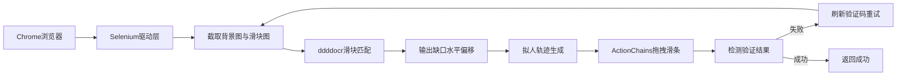

# 滑块拼图验证自动化技术方案

## 1. 范围与前提（已定稿假设）

因未收到进一步确认，按你原始需求采用如下默认边界：

| 项 | 定稿内容 |
|---|---|
| 目标能力 | 自动识别滑块缺口位置，模拟人手拖拽下方滑条完成拼图验证 |
| 技术栈 | **Selenium**（浏览器操控）+ **ddddocr**（缺口距离识别） |
| 交付形态 | 可复用的 Python 模块 + 可独立运行的演示脚本（后续实现阶段再写代码） |
| 适配对象 | [一网通办登录页](https://zwdtuser.sh.gov.cn/uc/login/login.jsp?kind=0&self=self&redirect_uri=https%3A//zwdt.sh.gov.cn/govPortals) 自研 `imgVer` 滑块（`#scream` / `#puzzleShadow` / `.slider-btn`） |
| 不在本期 | 完整账号登录闭环、语音验证码、绕过风控签名/设备指纹、批量撞库 |

使用前提：仅用于你有权操作的账号与业务流程（本人办事 / 授权 RPA / 自建系统联调）。对第三方站点请遵守其服务条款与相关法规。

---

## 2. 总体架构



核心思想：**识别与操控解耦**。

- 识别层只负责「缺口相对滑块初始位置的水平像素距离」
- 操控层只负责「按距离拟人拖动滑条，并判断成败」
- 上层业务（打开登录页、填账号等）调用本模块，不耦合验证码内部细节

---

## 3. 页面结构与元素定位策略

截图所示验证框典型结构：

1. 上方拼图区：背景大图 + 左侧可移动滑块图 + 右侧半透明缺口
2. 下方轨道：左侧圆形把手 + 提示文案「按住左边滑块，拖动完成上方拼图」
3. 刷新按钮、关闭按钮

### 3.1 定位原则

优先按稳定性排序：

1. **稳定 CSS / 自定义属性**（若站点有 `data-*`、固定 class）
2. **相对结构 XPath**（验证弹层内相对定位，避免整页绝对路径）
3. **文案辅助**：轨道内提示文字、刷新按钮 title

实现阶段需在真实页面上用 DevTools 确认选择器；本方案预留配置项（YAML/JSON）存放选择器，便于站点改版时只改配置不改逻辑。

### 3.2 必须拿到的两类图像

| 图像 | 用途 | 常见来源 |
|---|---|---|
| 背景图（含缺口阴影） | 匹配目标 | `` src / canvas / base64 / CSS background |
| 滑块小图（拼图块） | 匹配模板 | 独立 `` 或 canvas 裁切 |

若 DOM 只有一张合成图、滑块用 `transform` 叠加：可对拼图容器分别截图（整图 + 滑块元素截图），再交给 ddddocr。

注意：**识别用的是图片原始像素宽度，拖拽用的是页面 CSS 宽度**。二者往往不一致，必须做比例换算（见第 5 节）。

---

## 4. 缺口识别方案（ddddocr）

### 4.1 推荐接口

使用 ddddocr 的滑块专用能力（`slide_match`）：

- 输入：滑块小图 bytes、背景图 bytes
- 输出：缺口在背景图上的目标坐标（通常取 `target[0]` 作为水平偏移基准）

该类模型针对「缺口拼图」训练，比自写 OpenCV 模板匹配更省事、鲁棒性更好。

### 4.2 预处理建议

1. 去掉滑块图多余透明边（若有），避免匹配偏移
2. 若背景图带水印/强噪，可先轻度灰度化，但优先「原图直出」再视失败率加预处理
3. 统一以 PNG/JPEG bytes 传入，避免重复编解码损失

### 4.3 失败兜底（可选二期）

若 ddddocr 连续失败，可增加 OpenCV 边缘检测 + 轮廓匹配作为备用；一期以 ddddocr 单路径即可，降低复杂度。

---

## 5. 距离换算（关键正确性）

设：

- `distance_img` = ddddocr 算出的缺口水平位置（相对背景图左边缘，单位：图片像素）
- `bg_natural_width` = 背景图自然宽度（图片像素）
- `bg_display_width` = 背景图在页面中显示宽度（CSS 像素，Selenium `size['width']`）
- `slider_init_x` = 滑块初始相对背景的水平偏移（多数站点为 0 或接近 0）

则拖动距离：

```text
scale = bg_display_width / bg_natural_width
drag_distance = (distance_img - slider_init_x) * scale
```

若滑块小图本身有左边距，或缺口匹配点不是「块左缘对齐缺口左缘」，还需根据站点实测加减校正常量 `bias`（常见 ±2～8px）。校正值做成可配置项，上线后用 20～50 次样本微调。

下方进度条的可拖动最大行程通常约等于「背景显示宽度 − 滑块显示宽度」。拖动距离必须 clamp 到合法区间，避免拖出轨道。

---

## 6. 拟人拖拽方案（Selenium）

### 6.1 基本动作

1. 等待验证弹层可见、轨道把手可点击
2. `ActionChains.click_and_hold(handle)`
3. 按轨迹分多步 `move_by_offset(dx, dy)`
4. 短暂停顿后 `release()`
5. 等待成功/失败回调或 DOM 变化

### 6.2 轨迹必须「不像匀速直线」

服务端常检测：

- 总耗时过短/过长
- 完全匀速
- Y 轴零抖动
- 按下后零延迟立刻移动

推荐轨迹特征：

1. **按下后停顿** 50～150ms
2. **先快后慢**（ease-out）：前段步长大，接近终点步长变小
3. **轻微 Y 轴抖动**（±1～2px 随机）
4. **终点微调**：故意略过再回拉 1～3px，或最后几像素极慢挪动
5. **总时长随机化** 约 0.6～1.5s（按距离比例伸缩）

实现上可用简单公式生成点列，例如三次缓动或分段加速度；不必上复杂物理引擎。

### 6.3 浏览器侧注意

- 使用与本机 Chrome 版本匹配的 ChromeDriver（或 Selenium Manager 自动管理）
- 窗口最大化或固定分辨率，减少 DPI/缩放导致的距离误差
- 若页面在 iframe 内，必须先 `switch_to.frame`
- 拖拽过程中避免额外鼠标事件干扰

---

## 7. 结果判定与重试

### 7.1 成功信号（按优先级尝试）

1. 验证弹层消失
2. 出现「验证成功」类提示节点
3. 登录按钮变为可继续状态 / 出现后续请求成功标志
4. 监听页面 JS 回调或特定 cookie/header 变化（若可观测）

### 7.2 失败信号

1. 滑块弹回初始位置
2. 「请重试」文案
3. 拼图区自动刷新

### 7.3 重试策略

- 最大重试次数：3～5 次
- 失败后点击「刷新」，重新截图识别
- 两次尝试之间随机等待 0.5～1.5s
- 连续失败则向上层抛出明确异常（含最后一次截图路径，便于排障）

---

## 8. 推荐目录与模块划分（实现阶段）

```text
破盾工具/
  requirements.txt          # selenium, ddddocr, Pillow, 等
  config/
    selectors.yaml          # 元素选择器、校正 bias、重试次数
  src/
    browser.py              # 启动/关闭浏览器，等待封装
    captcha_capture.py      # 定位并导出背景图、滑块图、显示尺寸
    captcha_solver.py       # ddddocr 识别 + 距离换算
    human_drag.py           # 拟人轨迹 + ActionChains 拖拽
    verify_flow.py          # 编排：截图→识别→拖拽→判定→重试
  demos/
    run_slider_demo.py      # 对指定 URL 演示完整流程
  logs/                     # 运行日志与失败截图
  技术方案.md               # 本文档
```

依赖职责清晰后，业务脚本只需调用：

```text
ok = verify_flow.solve_slider(driver, config)
```

---

## 9. 实施步骤（落地顺序）

1. **人工走查页面**：确认验证码是否在 iframe、图片是 img 还是 canvas、成功/失败 DOM 变化
2. **写死选择器配置**：能稳定拿到背景图、滑块图、拖动把手、刷新按钮
3. **打通识别**：本地保存一对样本图，单独跑 ddddocr，目测框出缺口位置是否正确
4. **校准 scale 与 bias**：用 Selenium 量显示宽度，对比拖动距离与真实缺口，调到一次成功率 >80%
5. **接入拟人轨迹**：在已校准距离上替换为分段拖拽
6. **补齐判定与重试**：失败截图落盘，统计成功率
7. **封装对外 API**：供登录流程或其他业务调用

---

## 10. 风险与对策

| 风险 | 表现 | 对策 |
|---|---|---|
| 图片宽与显示宽不一致 | 总是偏左/偏右固定比例 | 强制 scale 换算 |
| 站点改版选择器失效 | 找不到元素 | 选择器外置配置 + 快速人工更新 |
| 行为风控 | 多次验证失败、触发二次验证 | 降频、加随机轨迹、避免并发刷同一账号 |
| ddddocr 环境问题 | Windows 下 onnxruntime 安装失败 | 固定兼容版本；必要时提供 CPU 版说明 |
| iframe / 影子 DOM | 元素 locatable 但不可交互 | 先切 frame；影子 DOM 用 JS 取节点 |
| 高 DPI / 浏览器缩放 | 偶发偏移 | 固定窗口大小、缩放 100% |

---

## 11. 验收标准

1. 在目标验证弹层出现后，模块可自动完成识别与拖拽，无需人工干预
2. 单次挑战成功率（识别+拖拽）在标定 bias 后稳定达到可用水平（建议目标 ≥80%，允许自动重试）
3. 失败时有日志与截图，可定位是「识别错」还是「拖拽被风控」
4. 业务侧只需传入已打开到验证步骤的 `WebDriver` 与配置，即可复用

---

## 12. 实现产出物

已落地：

1. `requirements.txt` 与 `README.md`
2. `src/` 模块与 `config/selectors.yaml`（已按 imgVer DOM 标定）
3. `demos/run_slider_demo.py`、`demos/probe_captcha_dom.py`
4. `logs/` 失败截图与识别样本目录

运行：

```bash
python demos/run_slider_demo.py --wait-only
```

---

## 13. 小结

**路径选定**：Selenium 负责打开与拖拽，ddddocr 负责缺口距离，中间用「图片像素 → CSS 像素」换算，再用缓动轨迹模拟真人拖动，失败则刷新重试。

这是可直接开工的一期方案；实现时最大工作量不在算法，而在**真实页面的元素定位、距离校准与结果判定**。
